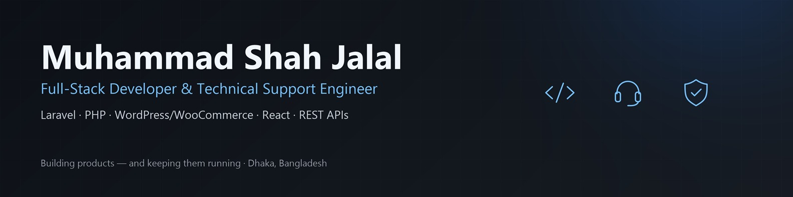

  

<h1 align="center">Muhammad Shah Jalal</h1>

  <strong>Full-Stack Developer & Technical Support Engineer · Laravel · WordPress/WooCommerce · React · AI Automation</strong>

  I build dependable web applications, e-commerce systems, backend integrations, and AI-assisted workflows that turn complex requirements into maintainable products — and I keep them running for the people who use them, providing technical support and QA for AI SaaS products.

  
  

## Professional Focus

Software professional with **4+ years of experience** across full-stack development, technical support, and quality assurance — one continuous track record of building products and keeping them running for the people who use them. Within that time, **3+ years** building and customizing WordPress and WooCommerce solutions and **2+ years** developing Laravel applications, APIs, business systems, and integrations.

Currently **Technical Support Engineer at Strontium Corp (Canada, remote)**, supporting three AI SaaS products (Artistly, CloneVoice, VideoExpress) end to end — Help Scout ticket ownership, defect reproduction, testing failed jobs against internal ML backend APIs, triage and escalation into Jira and Slack, and production QA — in a 15+ member global team providing 24/7 support in English. Hands-on infrastructure depth: **VPS and Cloudflare DNS management, TCP/IP, routing, DNS architecture, SSL/TLS and PKI, firewall rules, proxy and custom mail server configuration**, and **SSO/MFA (Authentik)** — alongside **AI-assisted development and automation** with Codex, Claude, local LLMs, n8n, and modern agentic workflows, including evaluating and benchmarking ML models for an ML team.

## Technical Foundation

### AI & Automation

### Backend & Business Systems

-334155?style=flat-square)

### Frontend & UI Development

### DevOps & Infrastructure

-334155?style=flat-square)

### Technical Support & QA

## Selected Projects

### RiceStream — Inventory & Financial Management ERP

**Laravel · React · Inertia.js · MySQL · Tailwind CSS**

- Built a dedicated ERP for rice mill owners and wholesalers with real-time inventory, dealer ledgers, payment tracking, and financial reporting.
- Implemented fixed-point calculations for accurate weight conversions, stock valuation, and due management.
- Optimized Eloquent queries and database indexes for fast account statements across large transaction histories.

[View repository](https://github.com/shahjalal132/arod-management-system)

### AI-Powered Bilingual QA & Compliance Engine

**Laravel · Gemini · Redis · MySQL · Alpine.js**

- Engineered an asynchronous auditing pipeline for large batches of URLs using Redis queues.
- Used structured AI output for consistent bilingual compliance reports and reduced token usage through server-side content sanitization.
- Built a configurable prompt engine so non-technical users can manage auditing rules without deployments.

[View repository](https://github.com/shahjalal132/ai-qa-assistant-tool)

### Trading Chart — LMS & Affiliate Platform

**Laravel · React · Inertia.js · MySQL · SSLCommerz**

- Developed a SPA-style learning platform with role-based access, protected course content, payment-driven enrollment, and affiliate commissions.
- Integrated a centralized multi-domain payment workflow and automated referral operations.

[Visit website](https://tradingchart.org/)

### Nursery-Rhyme Music Video Automation

**Codex · Claude · Artistly · CloneVoice · VideoExpress**

- Built an end-to-end AI-assisted workflow that converts nursery-rhyme concepts into structured music-video production assets.
- Automated repeatable content preparation steps to make the workflow accessible to end users.

[View repository](https://github.com/strontiumcorp/nursery_rhyme_music_video)

### Technical Support for AI SaaS Products — Artistly, CloneVoice & VideoExpress

**Help Scout · Jira · Slack · Loom · Internal ML Backend APIs**

- Currently provide technical support for three production AI SaaS products — [Artistly](https://artistly.ai/) (AI image generation), [CloneVoice](https://clonevoice.ai/) (AI voice cloning), and [VideoExpress](https://videoexpress.ai/) (AI video creation) — across Help Scout, Facebook product communities, and direct messages, in a 15+ member global team providing 24/7 support in English.
- Reproduce defects, test failed generation jobs against internal ML backend APIs and system logs, and return verified results to users; triage feature requests and issues into Jira and Slack, escalate to developers and ML engineers, and track fixes through to release.
- Deliver production-team QA (feature and API testing, staging-vs-production verification) and benchmark newly hosted ML models for the ML team.

### Maildoll — Email & SMS Marketing SaaS Application

**Laravel · PHP · MySQL**

- Contributed as a Software Developer at Imjol to Maildoll, the team's flagship CodeCanyon product — a self-hosted email and SMS marketing SaaS application built with Laravel, with 900+ sales.
- Worked on the product's ongoing development and lifecycle maintenance: resolving bugs from buyer feedback and reviews, shipping security patches, and sustaining compatibility with platform updates and high user ratings.
- Platform capabilities include bulk email and SMS campaigns, a drag-and-drop email builder, email verification, campaign scheduling, and SaaS subscription plans with PayPal and Stripe.

[View on CodeCanyon](https://codecanyon.net/item/maildoll-email-sms-marketing-application/30467920)

## GitHub Activity

  
  

  

  

## Let's Connect

I am interested in international opportunities involving full-stack product development, Laravel systems, WordPress/WooCommerce engineering, technical support engineering, AI automation, and technical collaboration.

- **Email:** rjshahjalal132@gmail.com
- **LinkedIn:** [linkedin.com/in/muhammad-jalal132](https://www.linkedin.com/in/muhammad-jalal132)
- **Facebook:** [facebook.com/shahjalal1320](https://facebook.com/shahjalal1320)
- **GitHub:** [github.com/shahjalal132](https://github.com/shahjalal132)
